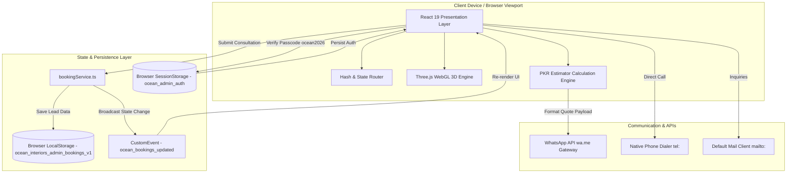

# The Ocean Interiors — Architectural Portfolio & Turnkey Management Platform

[](https://react.dev/)
[](https://www.typescriptlang.org/)
[](https://vitejs.dev/)
[](https://tailwindcss.com/)
[](https://threejs.org/)
[](https://opensource.org/licenses/Apache-2.0)

> **"Crafting calm, balanced residential interiors with peerless turnkey execution."**  
> Under the direct vision and architectural leadership of **Muhammad Mubashir Ali**, Founder & Chief Executive Officer.

---

## 📑 Table of Contents

1. [Project Overview](#-1-project-overview)
   - [Problem Statement](#problem-statement)
   - [Target Audience](#target-audience)
   - [Core Value Proposition](#core-value-proposition)
2. [Live Demonstrations](#-2-live-demonstrations)
3. [Features & Functionality](#-3-features--functionality)
   - [Real-Time 3D Spatial Room Simulation](#a-real-time-3d-spatial-room-simulation)
   - [Interactive Before & After Transformation Slider](#b-interactive-before--after-transformation-slider)
   - [Pakistani Turnkey Cost & PKR Budget Estimator](#c-pakistani-turnkey-cost--pkr-budget-estimator)
   - [Curated 6-Residence Architectural Gallery & Lightbox](#d-curated-6-residence-architectural-gallery--lightbox)
   - [CEO Direct Access & Executive Contact Suite](#e-ceo-direct-access--executive-contact-suite)
   - [Studio Team Order & Booking Management Pipeline (`#admin`)](#f-studio-team-order--booking-management-pipeline-admin)
   - [Interactive Material & Bespoke Texture Swatches Explorer](#g-interactive-material--bespoke-texture-swatches-explorer)
   - [Digital Studio Lookbook Modal](#h-digital-studio-lookbook-modal)
4. [Pages and Application Modules](#-4-pages-and-application-modules)
5. [Technology Stack](#-5-technology-stack)
6. [System Architecture](#-6-system-architecture)
   - [High-Level Architectural Diagram](#high-level-architectural-diagram)
   - [Data & State Lifecycle Flow](#data--state-lifecycle-flow)
7. [Project Structure](#-7-project-structure)
8. [Installation & Local Development](#-8-installation--local-development)
   - [Prerequisites](#prerequisites)
   - [Step-by-Step Setup](#step-by-step-setup)
   - [Available NPM Scripts](#available-npm-scripts)
9. [Environment Variables & Configuration](#-9-environment-variables--configuration)
10. [Database & Data Persistence](#-10-database--data-persistence)
11. [API & External Integration Points](#-11-api--external-integration-points)
12. [Security, Access Control & Privacy](#-12-security-access-control--privacy)
13. [Code Quality & Testing](#-13-code-quality--testing)
14. [Production Build & Deployment Guide](#-14-production-build--deployment-guide)
15. [Current Implementation Status & Known Boundaries](#-15-current-implementation-status--known-boundaries)
16. [Product Roadmap](#-16-product-roadmap)
17. [Troubleshooting & Frequently Asked Questions (FAQ)](#-17-troubleshooting--frequently-asked-questions-faq)
18. [Contribution Guidelines](#-18-contribution-guidelines)
19. [License & Executive Contacts](#-19-license--executive-contacts)
20. [Executive Project Summary for Clients & Investors](#-20-executive-project-summary-for-clients--investors)

---

## 🏛️ 1. Project Overview

**The Ocean Interiors** digital platform is an interactive architectural portfolio, client visualizer, and turnkey project management system. Engineered with modern web standards (React 19, Three.js, TypeScript, and Tailwind CSS v4), the platform bridges the gap between high-concept architectural design and on-site civil reality.

### Problem Statement
In the luxury residential and commercial interior design sector—particularly across major metropolitan hubs such as Karachi, Lahore, and Islamabad—prospective property owners face three critical friction points:
1. **Visualization Disconnect**: Static 2D AutoCAD drawings and low-resolution JPEG renders do not convey how spatial volume, natural daylight, and physical materials interact at scale.
2. **Pricing Opacity**: General contractors frequently issue vague lump-sum quotes, leading to hidden contractor markups, mid-construction budget disputes, and delayed handovers.
3. **Execution & Accountability Gaps**: Design consultations are often conducted by third-party sales representatives who pass projects to unvetted subcontractors, eliminating design fidelity.

### Target Audience
- **Discerning Homeowners & Villa Owners**: Private patrons commissioning luxury residences, farmhouses, and penthouses in Defense Housing Authority (DHA Phases 5–8), Clifton, Bahria Town, Gulberg, and Sector F-6/F-7.
- **Overseas Pakistani Patrons**: Expatriate homeowners residing in the United Kingdom, United States, UAE, Canada, and Saudi Arabia requiring trustworthy, turnkey residential project delivery with transparent budget estimation and remote verification.
- **Commercial & Corporate Decision Makers**: Executives seeking executive boardrooms, boutique headquarters, and flagship lounges.
- **The Ocean Interiors Studio Team & Leadership**: Studio architects, site engineers, and CEO Muhammad Mubashir Ali who require an operational pipeline to manage client consultations, site surveys, and bill of quantities (BOQ).

### Core Value Proposition
- **Real-Time Spatial Confidence**: Clients inspect spaces in 360° 3D with dynamic sun/lighting controls and switchable finish materials (Calacatta marble, fluted walnut, natural oak) before site excavation or procurement begins.
- **Itemized Financial Transparency**: A built-in cost estimator provides accurate preliminary budgets calibrated in Pakistani Rupees (PKR) across customizable land units (5 Marla, 10 Marla, 1 Kanal, 2 Kanal, and custom sq ft).
- **Principal-Led Accountability**: Direct line of contact to CEO Muhammad Mubashir Ali for project governance, milestone schedules, and execution guarantees.

---

## 🌐 2. Live Demonstrations

The application is deployed on Google Cloud Run and accessible globally:

| Environment | Purpose | URL |
| :--- | :--- | :--- |
| **Production Preview (Shared)** | Official client showcase and stakeholder review | [Launch Production App](https://ais-pre-prigwilmvwy2qwh3cz5gfy-928822422106.asia-southeast1.run.app) |
| **Development Staging** | Active development environment | [Launch Staging App](https://ais-dev-prigwilmvwy2qwh3cz5gfy-928822422106.asia-southeast1.run.app) |

*Note: For mobile clients, open the link in Safari (iOS) or Chrome (Android). All WebGL features are GPU-accelerated and fully responsive across mobile, tablet, and desktop viewports.*

---

## ✨ 3. Features & Functionality

### A. Real-Time 3D Spatial Room Simulation
Located directly in the main showcase (`src/components/SpatialRoom3D.tsx`), this module executes a complete Three.js WebGL canvas without external plugins or heavy model downloads:
- **360° Orbit & Pan Controls**: Smooth damping orbit controls allow the client to inspect ceiling heights, architectural open-riser oak staircases, and furniture layouts.
- **Dynamic Daylight & Lighting Engine**:
  - *Morning Sunrise*: Low-angle golden sun with crisp morning shadows and cool ambient fill.
  - *Afternoon Sunlight*: Bright, diffuse daylight emphasizing natural wood textures.
  - *Warm Evening Ambience*: Soft cove lighting, warm spotlighting, and dark exterior night vistas.
- **Material Customization System**:
  - *Italian Calacatta Gold Marble*: High-gloss, luxury veined stone.
  - *Roman Travertine*: Organic matte pitted stone texture.
  - *Fluted American Walnut*: Acoustic vertical slat millwork.
  - *Blonde White Oak*: Scandinavian minimalist natural timber.
- **Interactive Architectural Hotspots**: Clickable annotations highlight the custom linen lounge, fluted center table, open-tread staircase, and sculptural woven lantern.
- **Full-Screen Immersion**: One-click expansion into an edge-to-edge canvas with quick camera presets (*Default*, *Lounge View*, *Staircase Angle*, *Top-Down Plan*).

### B. Interactive Before & After Transformation Slider
Demonstrating real-world turnkey capability (`src/components/TransformationSlider.tsx`):
- **Split-Screen Comparison**:
  - *Left (Before)*: Bare red brickwork, unfinished concrete floor screed, exposed PVC electrical conduits, and raw unplastered walls.
  - *Right (After)*: Completed luxury interior featuring bookmatched porcelain slabs, recessed LED magnetic track lighting, acoustic fluted panels, and custom furniture.
- **Fluid User Interaction**: Drag the circular dividing handle across touch and mouse events, or select one-click presets (*Raw Unfinished*, *Split 50/50*, *Finished Luxury*).

### C. Pakistani Turnkey Cost & PKR Budget Estimator
Engineered specifically for Pakistani real estate metrics (`src/components/CostEstimator.tsx`):
- **Space Category Presets**: Grand Living & Dining Lounge (850 sq ft), Master Bed Suite (600 sq ft), Luxury Open Kitchen (350 sq ft), Complete Penthouse (3,200 sq ft), Turnkey Villa (5,500 sq ft), Executive Office (1,800 sq ft), or Custom Covered Area.
- **Pakistani Land Unit Presets**: One-click sizing for `5 Marla` (1,125 sq ft), `10 Marla` (2,250 sq ft), `1 Kanal` (4,500 sq ft), and `2 Kanal` (9,000 sq ft).
- **Execution Finish Tiers**:
  1. *Executive Turnkey* (~PKR 3,400 / sq ft): Natural veneers, quartz surfaces, concealed LED profiles.
  2. *Signature Ocean* (~PKR 5,200 / sq ft) [Most Selected]: Solid fluted walnut, imported porcelain slabs, Philips Hue lighting scenes.
  3. *Royal Bespoke Heritage* (~PKR 7,800 / sq ft): Italian Calacatta marble, acoustic joinery, Lutron home automation, 5-year warranty.
- **Optional Architectural Add-ons**: Smart Home Automation (+PKR 350/sq ft), Italian Marble Upgrade (+PKR 650/sq ft), and German Kitchen Appliance Package (+PKR 480,000).
- **1-Click WhatsApp Direct Quote**: Formats the selected scope, dimensions, finish tier, and estimated budget into a structured message and opens WhatsApp directly to CEO Muhammad Mubashir Ali (`0342-8156086`).

### D. Curated 6-Residence Architectural Gallery & Lightbox
Curated portfolio display (`src/components/FeaturedProjects.tsx` and `src/components/ProjectDetailPage.tsx`):
- **Uniform Geometric Grid**: Strict 4:3 architectural framing across all six residences to ensure visual balance.
- **Comprehensive Project Specs**: Displays covered area (sq ft), location/city, design category, architectural style, and handover year.
- **Dedicated Project Detail Page**: Deep-dive views with rich architectural narratives, material specifications, key engineering features, and full-screen lightbox galleries (`src/components/ImageLightboxModal.tsx`).

### E. CEO Direct Access & Executive Contact Suite
Eliminates intermediate sales barriers (`src/components/CeoProfile.tsx` and `src/components/FloatingContactWidget.tsx`):
- **Leadership Profile**: Biography, architectural philosophy, and personal quality guarantee from CEO Muhammad Mubashir Ali.
- **Verified Communication Channels**:
  - *Direct Mobile*: `0323-2930657` (with `tel:` protocol dialer)
  - *WhatsApp Direct*: `0342-8156086` (pre-filled chat initiator)
  - *Official Email*: `alimuhammd98573@gmail.com` (with clipboard copy feedback)
- **Floating Omnipresent Widget**: Desktop/mobile bottom-right quick-action dock for instantaneous consultation booking or phone calling.

### F. Studio Team Order & Booking Management Pipeline (`#admin`)
Built-in client relationship and site management system (`src/components/AdminPanelModal.tsx` and `src/services/bookingService.ts`):
- **Access Route**: Open via URL hash (`#admin` or `#portal`) or the footer link.
- **Passcode Authentication**: Protected by default passcode `ocean2026` (with `7860` or `ceo` alternatives), verified against `sessionStorage`.
- **5-Stage Pipeline Kanban/Table**:
  1. `New Inquiry`: Inbound web consultations or estimator leads.
  2. `Contacted`: Initial scope discussion completed.
  3. `Site Survey Scheduled / Done`: Dimensional survey completed on site.
  4. `Quotation Sent`: Formal itemized BOQ delivered to client.
  5. `Awarded / Active`: Turnkey civil and interior execution in progress.
- **Team Utilities**: Search by client name or city, status filtering, manual lead entry creation, internal timestamped notes logging, and **1-Click CSV / Excel Export** for studio record-keeping.

### G. Interactive Material & Bespoke Texture Swatches Explorer
Showcases artisanal finishes (`src/components/MaterialSwatchesExplorer.tsx`):
- High-fidelity texture inspections for *Natural Blonde White Oak*, *Honed Calacatta Marble*, *Tactile Bouclé Fabric*, *Brushed Champagne Brass*, and *Acoustic Fluted Walnut*.

### H. Digital Studio Lookbook Modal
Self-contained digital profile (`src/components/LookbookModal.tsx`):
- Complete downloadable/printable firm brochure summarizing design philosophy, turnkey methodology, materials palette, and warranty commitments.

---

## 🧭 4. Pages and Application Modules

| Component / Module | File Path | Purpose & Client Interaction |
| :--- | :--- | :--- |
| **Header Navigation** | `src/components/Header.tsx` | Fixed navigation bar with branding logo, navigation anchors (`#studio`, `#projects`, `#services`, `#pricing`), CEO WhatsApp pill, and consultation modal trigger. |
| **Hero Section** | `src/components/Hero.tsx` | Editorial title, architectural visual, credentials, and dual CTAs: "Explore Residences" and "Book Consultation". |
| **Transformation Slider** | `src/components/TransformationSlider.tsx` | Interactive split-handle slider contrasting raw grey structure vs finished luxury handover. |
| **Cost Estimator** | `src/components/CostEstimator.tsx` | Real-time budget calculator in Pakistani Rupees (PKR) with Marla/Kanal presets and 1-click WhatsApp quote generator. |
| **Spatial Room 3D** | `src/components/SpatialRoom3D.tsx` | Interactive Three.js WebGL canvas with 360° orbit, daylight control, and material swatches. |
| **Featured Projects** | `src/components/FeaturedProjects.tsx` | Six curated residences displayed in a uniform 4:3 grid with category filters and lightbox triggers. |
| **Project Detail View** | `src/components/ProjectDetailPage.tsx` | Full-page editorial view of a selected project with material lists, design narrative, and high-res imagery. |
| **Execution Process** | `src/components/ExecutionProcess.tsx` | 4-step turnkey roadmap: 1. Spatial Discovery, 2. Photorealistic 3D, 3. Turnkey Execution, 4. White-Glove Handover. |
| **CEO Leadership** | `src/components/CeoProfile.tsx` | Verified profile of CEO Muhammad Mubashir Ali with direct phone, WhatsApp, and email copy buttons. |
| **Material Swatches** | `src/components/MaterialSwatchesExplorer.tsx` | Visual and tactile inspection cards for primary interior finishes. |
| **Services Section** | `src/components/ServicesSection.tsx` | Comprehensive scope: Full Architecture, Interior Renovation, Bespoke Joinery, Lighting & MEP. |
| **FAQ Accordion** | `src/components/FaqSection.tsx` | Clarifications on project timelines, overseas client management, milestone payments, and warranty coverage. |
| **Consultation Modal** | `src/components/ConsultationModal.tsx` | Full lead intake form with phone, city, budget, timeframe, and auto-dispatch to `bookingService`. |
| **Admin Panel Modal** | `src/components/AdminPanelModal.tsx` | Passcode-protected pipeline tracker with search, notes, lead creation, and CSV export. |
| **Footer** | `src/components/Footer.tsx` | Legal disclaimers, contact credentials, copyright, and hidden administrative access trigger. |

---

## 💻 5. Technology Stack

| Category | Technology | Version | Purpose in Application |
| :--- | :--- | :--- | :--- |
| **Core Framework** | **React** | `^19.0.1` | Component architecture, hooks (`useState`, `useRef`, `useMemo`, `useEffect`), and reactive rendering. |
| **Language** | **TypeScript** | `^7.0.2` / `^5.8` | Static typing, interface contracts (`Project`, `BookingLead`, `SpaceConfig`), and strict compile-time validation. |
| **Build Tool & Bundler** | **Vite** | `^8.3.0` | Ultra-fast Hot Module Replacement, optimized ES module bundling, and zero-config asset imports. |
| **Styling & CSS** | **Tailwind CSS v4** | `^4.3.3` | Modern utility-first styling using `@tailwindcss/vite` without legacy config clutter. |
| **3D Graphics Engine** | **Three.js** | `^0.186.1` | WebGL scene graph, perspective cameras, ambient/directional lights, custom geometry, and `OrbitControls`. |
| **Animation & UI Motion** | **Motion** (Framer) | `^12.23.24` | Smooth transitions, modal entry/exit animations, and accordion state changes. |
| **Iconography** | **Lucide React** | `^0.546.0` | Clean, lightweight SVG icons for navigation, WhatsApp, dials, and administrative controls. |
| **State & Persistence** | **Browser Storage** | Native Web APIs | `localStorage` for client bookings; `sessionStorage` for admin auth session; `CustomEvent` for reactive cross-component synchronization. |
| **Server Framework** | **Express** *(Prepared)* | `^4.21.2` | Prepared backend foundation for proxy routes and automated server-side notifications. |
| **AI Integration** | **@google/genai** *(Prepared)* | `^2.4.0` | Prepared SDK for generative interior room concepts and automated BOQ extraction. |

---

## 🏗️ 6. System Architecture

The application is structured as a client-side Single Page Application (SPA) with a modular component architecture, reactive state management, and real-time WebGL rendering:

### High-Level Architectural Diagram



### Data & State Lifecycle Flow

```
1. Client Form Submission / Estimator Quote
   │
   ├─► Client inputs property details (e.g., 1 Kanal, DHA Phase 6, PKR 22.5M)
   │
   ├─► bookingService.createBooking() generates unique Reference ID (OI-2026-XXXX)
   │
   ├─► Lead appended to localStorage (key: ocean_interiors_admin_bookings_v1)
   │
   ├─► window.dispatchEvent('ocean_bookings_updated') triggers instant reactive update
   │
   └─► Admin Modal instantly reflects new lead under "New Inquiry" status with audio/visual cues
```

---

## 📁 7. Project Structure

```
├── .env.example                # Template for environment variables
├── .gitignore                  # Git ignore rules for node_modules, dist, and local env files
├── README.md                   # Comprehensive project documentation
├── bun.lock                    # Bun lockfile for reproducible dependency resolution
├── index.html                  # HTML5 entry point with OpenGraph tags and Plus Jakarta Sans font
├── metadata.json               # AI Studio project capabilities and permissions
├── package.json                # Project dependencies, scripts, and package metadata
├── tsconfig.json               # TypeScript compiler configuration (strict mode, ESNext)
├── vite.config.ts              # Vite 8 configuration with React and Tailwind CSS v4 plugins
│
├── public/                     # Static assets served at web root
│   └── assets/                 # Production-served media (copied to /dist on build)
│       ├── images/             # High-resolution architectural photography & projects
│       └── aistudio/           # CEO headshots and brand assets
│
└── src/                        # Main application source directory
    ├── App.tsx                 # Root component orchestrating page layouts, modals, and navigation
    ├── main.tsx                # React DOM entry point rendering App with StrictMode
    ├── index.css               # Global Tailwind CSS imports (@import "tailwindcss";)
    │
    ├── assets/                 # High-resolution architectural photography and media
    │   └── images/             # Project residences, before/after captures, and materials
    │
    ├── components/             # Reusable, modular UI components
    │   ├── AdminPanelModal.tsx # Passcode-protected pipeline tracker and CSV exporter
    │   ├── CeoProfile.tsx      # CEO Muhammad Mubashir Ali profile & direct contact buttons
    │   ├── ConsultationBanner.tsx # Full-width photographic call-to-action section
    │   ├── ConsultationModal.tsx  # In-depth consultation booking modal with input validation
    │   ├── CostEstimator.tsx   # Interactive PKR budget calculator with Marla/Kanal presets
    │   ├── ExecutionProcess.tsx # 4-step turnkey delivery roadmap
    │   ├── FaqSection.tsx      # Interactive FAQ accordion for client queries
    │   ├── FeaturedProjects.tsx# 6-residence portfolio grid with uniform 4:3 aspect ratios
    │   ├── FloatingContactWidget.tsx # Floating quick-dial and WhatsApp action dock
    │   ├── Footer.tsx          # Architectural editorial footer with legal & admin triggers
    │   ├── Header.tsx          # Fixed luxury header with navigation links and contact pills
    │   ├── Hero.tsx            # Hero showcase with headline, primary CTAs, and trust metrics
    │   ├── ImageLightboxModal.tsx # Full-screen image zoom modal
    │   ├── InteractiveCalculatorModal.tsx # Expanded stand-alone calculator modal
    │   ├── Logo.tsx            # Architectural vector emblem and typography
    │   ├── LookbookModal.tsx   # Digital studio lookbook and brochure modal
    │   ├── MaterialSwatchesExplorer.tsx # Interactive texture & material inspection cards
    │   ├── Philosophy.tsx      # Studio design philosophy and proportion standards
    │   ├── ProjectDetailPage.tsx # Dedicated deep-dive page for individual architectural works
    │   ├── ServicesSection.tsx # Detailed service offerings (Turnkey, Millwork, Lighting, Civil)
    │   ├── SpatialRoom3D.tsx   # Interactive Three.js WebGL 3D spatial simulation
    │   ├── Testimonials.tsx    # Verified client endorsements from prime Pakistani estates
    │   └── TransformationSlider.tsx # Interactive Before/After construction comparison slider
    │
    ├── data/                   # Structured content and mock database models
    │   ├── projectsData.ts     # Curated residence portfolio data (images, specs, narratives)
    │   └── servicesData.ts     # Detailed architectural services definitions
    │
    └── services/               # Core business logic and storage services
        └── bookingService.ts   # Lead creation, pipeline status changes, and CSV generator
```

---

## 🚀 8. Installation & Local Development

### Prerequisites
Before running the application locally, ensure you have the following installed on your machine:
- **Node.js**: `v18.0.0` or higher (Node.js `v20.x` or `v22.x` recommended)
- **Package Manager**: `npm` (v9+), `bun` (v1.0+), or `yarn`

### Step-by-Step Setup

1. **Clone the Repository**
   ```bash
   git clone https://github.com/your-username/the-ocean-interiors.git
   cd the-ocean-interiors
   ```

2. **Install Dependencies**
   Using standard NPM:
   ```bash
   npm install
   ```
   *Or using Bun for near-instant installation:*
   ```bash
   bun install
   ```

3. **Configure Environment Variables**
   Create a local `.env` file from the provided example:
   ```bash
   cp .env.example .env
   ```
   *(Note: The application runs with sensible defaults out of the box without requiring API keys for core UI and 3D features.)*

4. **Start the Development Server**
   ```bash
   npm run dev
   ```
   The development server starts on port `3000`:
   ```text
   VITE v8.3.0  ready in 240 ms

   ➜  Local:   http://localhost:3000/
   ➜  Network: http://192.168.1.X:3000/
   ```

5. **Access the Application**
   - Main Client Platform: `http://localhost:3000/`
   - Direct Studio Admin Portal: `http://localhost:3000/#admin` (Passcode: `ocean2026`)

### Available NPM Scripts

| Command | Action |
| :--- | :--- |
| `npm run dev` | Starts the Vite development server on `http://0.0.0.0:3000` with instant HMR. |
| `npm run build` | Compiles TypeScript and builds production-optimized assets into `/dist`. |
| `npm run preview` | Spins up a local static server to preview the production build in `/dist`. |
| `npm run lint` | Runs the TypeScript compiler (`tsc --noEmit`) to validate type contracts with zero side effects. |
| `npm run clean` | Removes compiled distribution artifacts (`rm -rf dist server.js`). |

---

## 🔐 9. Environment Variables & Configuration

The application includes a `.env.example` file at the root. The following parameters are supported:

| Variable Name | Required? | Default / Example | Purpose |
| :--- | :--- | :--- | :--- |
| `GEMINI_API_KEY` | Optional | `""` (Empty string) | Used for future server-side AI generative design and automated BOQ extraction. In Google AI Studio, this is injected automatically at runtime. |
| `APP_URL` | Optional | `http://localhost:3000` | The public URL of the application. Used for absolute link generation and potential OAuth redirect callbacks. |
| `PORT` | Optional | `3000` | Local port binding for Vite development server and containerized environments. |
| `DISABLE_HMR` | Optional | `false` | Set to `true` inside headless containerized agent environments to prevent file-watching resource overhead. |

> **Security Reminder**: Never commit `.env` or production API credentials to public version control. The repository's `.gitignore` explicitly excludes `.env` and `.env.local`.

---

## 🗄️ 10. Database & Data Persistence

Currently, the application implements a high-performance **Client-Side Reactive Persistence Engine** via `src/services/bookingService.ts`. This architecture delivers instantaneous response times with zero network latency:

### Data Model Schema (`BookingLead`)

```typescript
export interface BookingLead {
  id: string;                               // Unique internal identifier (e.g. 'lead-001')
  referenceId: string;                      // Formal client reference ID (e.g. 'OI-2026-8941')
  createdAt: string;                        // ISO 8601 creation timestamp
  clientName: string;                       // Full client name
  phone: string;                            // Contact telephone number
  email: string;                            // Email address
  city?: string;                            // Project location (e.g. 'DHA Phase 6, Lahore')
  projectType: string;                      // Scope category (e.g. '1 Kanal Full Turnkey Villa')
  estimatedBudget?: string;                 // Computed PKR budget (e.g. 'PKR 22,500,000')
  squareFeet?: string;                      // Covered area (e.g. '4,500 sq ft')
  consultationMethod: string;               // 'In-Studio Meeting' | 'On-Site Visit' | 'Video Call'
  timeframe?: string;                       // Construction urgency (e.g. 'Immediate')
  source: 'Consultation Form' | 'Cost Estimator' | '3D Studio' | 'Direct Walk-in';
  notes?: string;                           // Internal studio notes and milestones
  status: 'new' | 'contacted' | 'survey_done' | 'quote_sent' | 'awarded' | 'completed' | 'archived';
  lastUpdated: string;                      // ISO timestamp of last modification
  assignedTo?: string;                      // Responsible designer (e.g. 'Muhammad Mubashir Ali')
}
```

### Storage Mechanisms
1. **Local State (`localStorage`)**: Inbound consultation requests, manual client entries, and status updates persist under the key `ocean_interiors_admin_bookings_v1`.
2. **Session Authentication (`sessionStorage`)**: Administrative login state persists under `ocean_admin_auth = 'true'` during the active browser session.
3. **Cross-Component Event Bus**: Updates trigger a custom `ocean_bookings_updated` event on `window`, allowing open modals and badges to refresh without full-page reloads.
4. **Data Portability**: Studio administrators can export all records as a standard `.csv` spreadsheet at any time by clicking the "Export CSV" button.

---

## 🔌 11. API & External Integration Points

The application integrates seamlessly with native communication protocols and mobile operating systems:

```
[ Client Interface ]
        │
        ├─► WhatsApp API: https://wa.me/923428156086?text=<URL_ENCODED_PAYLOAD>
        │   Automatically populates property specs, budget, and contact info into CEO's WhatsApp.
        │
        ├─► Direct Telephony: tel:03232930657
        │   Triggers mobile dialer directly to CEO Muhammad Mubashir Ali.
        │
        ├─► Secure Mailto: mailto:alimuhammd98573@gmail.com?subject=<PROJECT_INQUIRY>
        │   Opens default mail client with pre-formatted inquiry headers.
        │
        └─► Clipboard API: navigator.clipboard.writeText(...)
            Provides immediate one-click copy feedback for contact numbers and email addresses.
```

---

## 🛡️ 12. Security, Access Control & Privacy

- **Client Data Privacy**: Inbound consultation requests submitted through the public website are stored strictly within the client's local session storage unless transmitted via WhatsApp or Email. No third-party data tracking or surveillance pixels are utilized.
- **Studio Administrative Gate**: The internal team order management portal requires authentication. Access is gated by passcode validation (`ocean2026`) with session persistence.
- **Sanitized Payloads**: Form inputs are validated for well-formed email addresses and required phone numbers before being committed to state.
- **Zero Hardcoded Secrets**: No sensitive cloud database credentials, payment gateways, or private keys exist in the codebase. All external links utilize official URI schemes.

---

## 🧪 13. Code Quality & Testing

### Static Type Checking
The repository enforces strict TypeScript rules configured in `tsconfig.json`. Run the type validation suite:
```bash
npm run lint
```
*Expected output on passing:*
```text
$ tsc --noEmit
# Process exits with code 0 (zero errors found)
```

### Production Build Validation
Verify that all assets, JSX templates, CSS variables, and Three.js modules bundle successfully:
```bash
npm run build
```

---

## 🚢 14. Production Build & Deployment Guide

### Deployment Options

#### Option 1: Static Hosting (Vercel, Netlify, Cloudflare Pages, GitHub Pages)
Since the application compiles to a high-efficiency client-side SPA, it can be hosted on any static edge network:
1. Set build command: `npm run build`
2. Set output directory: `dist`
3. Configure single-page rewrite rule: route all traffic to `/index.html`.

#### Option 2: Containerized Deployment (Google Cloud Run / Docker)
A standard minimal Dockerfile configuration for production:
```dockerfile
# Step 1: Build static assets
FROM node:20-alpine AS builder
WORKDIR /app
COPY package*.json bun.lock ./
RUN npm ci
COPY . .
RUN npm run build

# Step 2: Serve with lightweight Nginx
FROM nginx:alpine
COPY --from=builder /app/dist /usr/share/nginx/html
COPY nginx.conf /etc/nginx/conf.d/default.conf
EXPOSE 80
CMD ["nginx", "-g", "daemon off;"]
```

---

## 📊 15. Current Implementation Status & Known Boundaries

### Verified Implemented Features
- [x] Responsive editorial design tailored for luxury residential architecture.
- [x] Real-time 3D room visualizer with dynamic lighting presets and material switching.
- [x] Interactive Before & After construction comparison slider.
- [x] Comprehensive Pakistani turnkey PKR cost estimator with Marla/Kanal presets.
- [x] Pre-filled 1-click WhatsApp quote generator directed to CEO Muhammad Mubashir Ali.
- [x] Curated 6-residence portfolio grid with uniform 4:3 aspect ratios and lightbox modal.
- [x] Complete project deep-dive pages with materials breakdown and design narratives.
- [x] Studio management admin pipeline (`#admin`) with status updates, notes, and CSV export.
- [x] Digital Studio Lookbook modal and tactile material swatch explorer.
- [x] Full mobile touch optimization (iOS Safari & Android Chrome).

### Deliberate Boundaries & Known Notes
- **Local Persistence**: Client bookings and notes are stored locally in the browser's `localStorage`. Multi-device team synchronization currently relies on manual CSV exports or direct WhatsApp leads. (Cloud database sync is slated for Phase 2).
- **Backend API Server**: The Express framework is installed in `package.json` for future server-side proxy extensions; currently, all UI logic executes client-side for zero latency.

---

## 🗺️ 16. Product Roadmap

- [ ] **Cloud Database Synchronization**: Integrate Firebase Firestore or Cloud SQL (PostgreSQL) for multi-device real-time sync across site engineers and studio managers.
- [ ] **AI-Powered Interior Moodboard Generator**: Utilize `@google/genai` to generate custom concept renders based on client-uploaded floor plans.
- [ ] **Role-Based Access Control (RBAC)**: Multi-tier logins for Principal Architect, Senior Interior Designer, Site Supervisor, and Client Portal.
- [ ] **Automated PDF Contract & BOQ Generator**: Generate downloadable, print-ready formal contracts with itemized architectural milestones.
- [ ] **Live On-Site CCTV & Progress Stream**: Private portal for overseas clients to watch real-time site execution and drone survey footages.

---

## ❓ 17. Troubleshooting & Frequently Asked Questions (FAQ)

### Frequently Asked Questions

#### Q1: How do I access the Studio Order Management Portal?
**Answer**: Simply append `#admin` or `#portal` to the website URL (e.g., `http://localhost:3000/#admin`), or click the small "Team Portal" link in the website footer. When prompted, enter the official passcode: `ocean2026`.

#### Q2: The 3D Room simulation appears blank or runs slowly. What should I check?
**Answer**:
1. Ensure your browser has **Hardware Acceleration** enabled in settings (Chrome: *Settings > System > Use graphics acceleration when available*).
2. Check that WebGL 2.0 is supported by visiting `chrome://gpu`.
3. If testing inside an iframe or embedded preview, ensure the iframe allows WebGL and device orientation.

#### Q3: How do I update the pricing rates in the Cost Estimator?
**Answer**: Open `src/components/CostEstimator.tsx`. Locate the `TIERS` array (lines 58–80) to update rates per square foot (e.g. `ratePerSqFt: 3400`), or edit the `ADDONS` array (lines 90–110) to update smart automation or marble surcharges.

#### Q4: Why does `npm run dev` fail with "Port 3000 is already in use"?
**Answer**: Another process is occupying port 3000. Either terminate the existing process (`kill -9 $(lsof -t -i:3000)`) or run Vite on a different port:
```bash
npm run dev -- --port 3001
```

---

## 🤝 18. Contribution Guidelines

Contributions, bug reports, and architectural feature requests are welcome. Please follow these conventions:

1. **Fork & Branch**: Create a feature branch with a descriptive name:
   ```bash
   git checkout -b feature/3d-material-wood-grain
   ```
2. **Commit Hygiene**: Follow conventional commits (`feat: add travertine floor preset`, `fix: adjust mobile slider touch sensitivity`).
3. **Verify Code Quality**: Always run `npm run lint` and `npm run build` prior to opening a Pull Request.
4. **Pull Request Review**: Ensure code is documented and does not degrade performance or increase initial bundle size unnecessarily.

---

## 📜 19. License & Executive Contacts

### License
This project is open-source and distributed under the **Apache-2.0 License**. See the `package.json` and file headers for complete license terms.

### Executive Leadership & Studio Contact
For architectural commissions, site inspections, investor inquiries, or turnkey interior execution:

* **Studio Name**: **The Ocean Interiors**
* **Principal & CEO**: **Muhammad Mubashir Ali**
* **Direct Mobile**: `+92 323 2930657`
* **WhatsApp Direct**: `+92 342 8156086` ([Click to Chat](https://wa.me/923428156086?text=Hello%20Muhammad%20Mubashir%20Ali,%20I%20am%20contacting%20you%20regarding%20The%20Ocean%20Interiors%20design%20services))
* **Official Inquiries Email**: `alimuhammd98573@gmail.com`
* **Regional Coverage**: Karachi (DHA, Clifton, Bahria), Lahore (DHA, Gulberg), Islamabad (F-Sector, Bahria), and Overseas Patrons (UK, UAE, USA, Canada).

---

## 📌 20. Executive Project Summary for Clients & Investors

| Key Dimension | Summary Details |
| :--- | :--- |
| **Product Essence** | An enterprise-grade architectural portfolio, real-time 3D spatial simulation, and turnkey interior design management platform. |
| **Target Audience** | Discerning luxury villa/penthouse owners, overseas Pakistani investors, corporate executives, and studio project managers. |
| **Signature Capabilities** | Real-time WebGL 3D room orbit with daylight slider; interactive Before/After construction transformation slider; instant PKR budget estimator with 1-click WhatsApp quotes; curated 6-residence portfolio; and an authenticated studio management pipeline (`#admin`). |
| **Core Value Delivered** | Eliminates visual guesswork, brings 100% financial transparency to construction budgets in Pakistani Rupees, and guarantees direct accountability under CEO Muhammad Mubashir Ali. |
| **Current Status** | Fully implemented, compiled, and deployed live with zero lint errors; ready for immediate client demonstration and project intake. |
